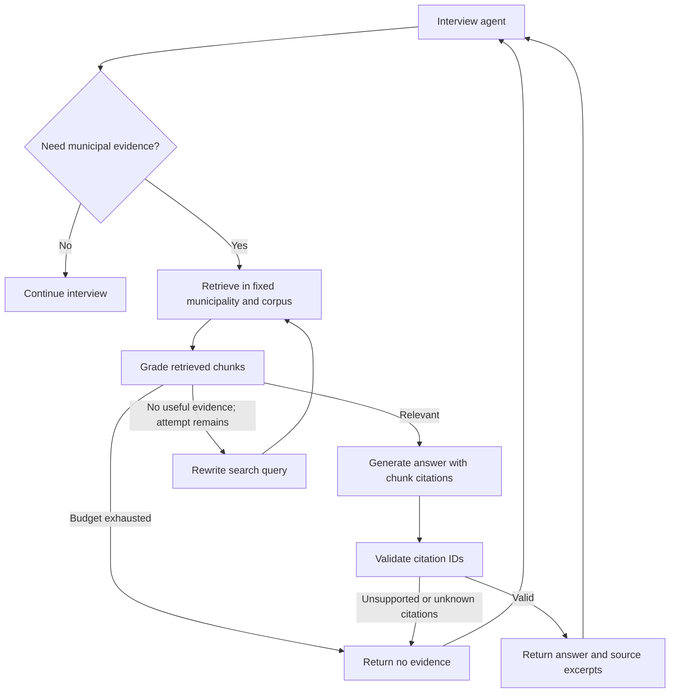

# Municipal document RAG

The scaffold is ready to receive approved city hall process documents. No municipal
vector embeddings or live model evaluations have been run. A separate public
[Cascavel article corpus](../../knowledge_base/README.md) now supports lexical
retrieval with explicit legal-coverage gaps; it does not use this generic ingestion
manifest or imply verified current municipal requirements. The
tracked example is explicitly synthetic. Embedding and retrieval quality must
be evaluated once the documents arrive.

The [phase workflow and organization review](rag_testing_flow.md) maps the
reference project's `rag_phase` organization to this repository. It adds shared
datasets, experiment variants, Phase 0–3 runners and local reports without
changing the default requirement for explicit embedding/provider execution.

## Agentic flow

This follows the [LangGraph agentic RAG tutorial](https://docs.langchain.com/oss/python/langgraph/agentic-rag).
The existing LangChain interview makes the retrieve-or-respond decision. Its
`search_municipal_documents(query)` tool runs a LangGraph subgraph for the
remaining steps. This keeps the current form adapter and avoids a second
decision model that would duplicate the interview agent's tool choice.



Default: at most two retrieval attempts, with one query rewrite. Generation
uses the original question and only the chunks selected by grading. A missing
index returns `not_configured`; an exhausted search returns `no_evidence` with
no answer or sources. Retrieval/provider/invalid-schema errors propagate to the
adapter; they are not disguised as absent documents. Each call starts with
fresh state, without a checkpointer or independent conversation store.

Relevance grading and citation-ID checks constrain the answer, but cannot prove
that a generated claim follows from a passage or that a law remains applicable.
The interview proposes document-derived requirements for representative review.
It does not automatically turn them into accepted form answers.

## Files and responsibilities

| Location | Purpose |
| --- | --- |
| `app/rag/schemas.py` | Internal manifest, scope, chunk settings, index and evidence models |
| `app/rag/loaders.py` | Explicit local TXT/Markdown, PDF and DOCX loading |
| `app/rag/ingest.py` | Offline preparation, source provenance and deterministic chunk IDs |
| `app/rag/store.py` | Persistent Chroma snapshots and fixed-scope retrieval |
| `app/rag/workflow.py` | Grade/rewrite/generate graph and `MunicipalRag` facade |
| `app/rag/providers.py` | Explicit server-side OpenAI embedding setup |
| `app/rag/evaluation.py` | Validated phase datasets/matrix, metrics and reports |
| `scripts/ingest_municipal_docs.py` | Preview and opt-in embedding CLI |
| `scripts/rag_phase0.py`, `rag_phase1_runner.py`, `rag_phase2_runner.py`, `rag_phase3_runner.py` | Phase preparation, retrieval comparisons and agentic RAG evaluation |
| `tests/rag/` | Phase-marked regression checks, synthetic dataset and experiment matrix |
| `examples/rag/` | Synthetic manifest and document for offline checks |
| `data/municipal/` | Local incoming documents/manifests; ignored by Git |
| `.local/rag/` | Local vector indexes; ignored by Git |

The public Aprova API pack remains separate under `knowledge/aprova/`; it is
not automatically added to a municipal corpus.

## Install and preview without credentials

From the repository root:

```powershell
uv sync --project agents --extra rag --locked
uv run --project agents --extra rag python -m agents.scripts.ingest_municipal_docs agents/examples/rag/manifest.synthetic.json
uv run --project agents --extra rag pytest agents/tests
```

Preview loads and chunks the listed files in memory. It prints counts and
configuration, without source text, vector-store writes or provider requests.
TXT/Markdown preview also works with the base installation. PDF, DOCX and Chroma
require the optional `rag` dependencies. Store and office-format tests skip
when those dependencies are absent; use `--extra rag` for full validation.

## When the municipal documents arrive

Create an ignored folder such as `agents/data/municipal/<municipality-id>/`.
Keep the approved documents and a manifest there. Each manifest explicitly
lists files; ingestion never scans the workspace or fetches source URLs.
Use the structure in [the synthetic manifest](../examples/rag/manifest.synthetic.json):

| Field | Meaning |
| --- | --- |
| `schema_version` | `1` |
| `scope.municipality_id` | Stable backend municipality identifier, preferably the agreed IBGE code |
| `scope.municipality_name` | Municipality name used by the session; trimmed/case-insensitive matching |
| `scope.corpus_id` | Stable name for the approved document set |
| `data_kind` | `municipal_documents` for supplied sources; `synthetic` for demonstrations |
| `documents[].document_id` | Unique stable ID within the corpus |
| `documents[].title` | Source title for citations |
| `documents[].path` | Path relative to the manifest directory; must remain inside it |
| `documents[].kind` | `legislation`, `procedure`, `form`, `manual` or `other` |
| `documents[].source_url` | Optional original publication URL; unknown is `null`; never fetched |
| `documents[].version` | Optional supplied revision/version; unknown is `null` |

Only approved procedural/reference material belongs in the corpus. Do not put
employee or citizen production records in it. Preserve the source language.
PDF pages retain one-based page numbers. TXT/Markdown and DOCX use `page: 0`
to mean unpaginated. DOCX paragraphs and tables are extracted in body order;
headers, footers, images and complex layout are outside this loader. Any blank
or unreadable PDF page stops preparation rather than silently omitting content;
review/extract/OCR that source first. There is no OCR service configured.

Start with 1000-character chunks and 200-character target overlap using
[RecursiveCharacterTextSplitter](https://docs.langchain.com/oss/python/integrations/splitters/recursive_text_splitter).
Adjust `--chunk-size` and `--chunk-overlap` after checking the actual documents,
especially tables, legal articles and cross-references. The sizes are character
counts, not token limits. Preview before embedding; a local developer can
inspect `prepare_corpus(Path(manifest)).chunks` for content review.

## Explicit embedding and indexing

Set `EMBEDDING_MODEL` and a server-side `EMBEDDING_API_KEY` (or use the existing
`MODEL_API_KEY` fallback) in the launching process. No `.env` file is loaded
automatically. The model is deliberately not chosen by default.

Example command for the supplied synthetic corpus; execute it only when you
intend to send its chunks to the embedding provider:

```powershell
uv run --project agents --extra rag python -m agents.scripts.ingest_municipal_docs agents/examples/rag/manifest.synthetic.json --embed --index-dir agents/.local/rag/example-city
```

For real documents, replace the manifest/index paths with their approved local
counterparts. Embeddings go to OpenAI; vectors, text and source metadata persist
locally in [Chroma](https://docs.langchain.com/oss/python/integrations/vectorstores/chroma).
Querying later sends the search query to the same embedding provider and sends
retrieved passages to the configured chat model. Tracing stays opt-in because
it can also transmit passages and prompts.

The index descriptor records the municipality, corpus, data kind, embedding
provider/model and chunk settings. A fingerprint of the manifest, chunk IDs,
settings and embedding model selects a collection. Repeated builds reuse
existing IDs. Changed sources/configuration create a new collection, so stale
chunks are not returned from the active snapshot. The descriptor is replaced
atomically only after all expected chunks are present; failed builds leave the
previous snapshot selected. Use one ingestion writer per index directory.
Historical/failed-build collections remain on disk for operator cleanup.
Changing the embedding model requires rebuilding; arbitrary provider/dimension
overrides are not exposed by the initial adapter.

## Connect the interview

After an index exists, the local CLI supports:

```powershell
uv run --project agents --extra rag python -m agents contracts/examples/agent-request.json --rag-index agents/.local/rag/example-city
```

The request's municipality must match the index scope. The CLI also needs the
existing `MODEL_PROVIDER=openai`, `MODEL_NAME`, `MODEL_API_KEY` and matching
embedding settings. The synthetic request and corpus are demonstration material.

The backend can inject the service directly:

```python
from pathlib import Path

from agents.app.rag.providers import embeddings_from_environment
from agents.app.rag.store import ChromaMunicipalRetriever
from agents.app.rag.workflow import MunicipalRag
from agents.interview import ProcessInterviewAgent

embeddings, spec = embeddings_from_environment()
# server_selected_index must come from authorized backend configuration.
retriever = ChromaMunicipalRetriever(Path(server_selected_index), embeddings, spec)
rag = MunicipalRag(rag_model, retriever)
agent = ProcessInterviewAgent(interview_model, municipal_rag=rag)
result = agent.invoke(request)
```

The backend must authorize the index selection for the session. Municipality
name matching alone is not authentication, and a user/model must not choose a
filesystem path or scope through chat. A search tool accepts only a query, uses
municipality/corpus metadata filters, and validates every returned chunk against
the fixed scope. A separate index directory is required for each municipality
and corpus. Local Chroma is the initial persistence choice; distributed access,
authorization and multi-writer indexing require separate deployment work.

Sources returned to the interview carry document/chunk IDs, title, relative
source path, optional source URL/version, original-file SHA-256, PDF page or
unpaginated marker, start offset, data kind and excerpt. The public agent-result
and form contracts remain unchanged, so structured citation persistence is not
available yet. The prompt keeps references in the conversation and explicitly
distinguishes source evidence from employee acceptance. A future contract
migration must add durable provenance across backend, agent and frontend.

RAG adds model/embedding calls. The provided CLI uses 10-second RAG chat-call
timeouts and no automatic provider retries; each tool search has a bounded
graph. These per-call bounds do not replace the backend's existing overall
60-second deadline, which must cover the entire interview turn.
