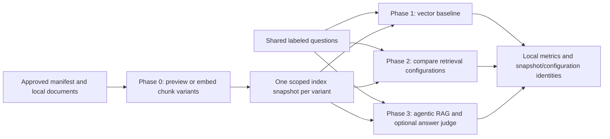

# RAG phases and organization review

Reviewed on 2026-10-24 against the user-supplied local `ai-agent-sales` repository:
its `scripts/rag_phase0.py`, Phase 2/3 runners, `tests/rag/`, experiment template,
Makefile, pytest markers and RAG testing guide. The organization now follows its
four-phase sequence, with explicit differences for this municipal application.
No course data, credentials, logs, reports, skill files or database resets were
copied.

## Organization audit

| Reference pattern | Current project | Finding |
| --- | --- | --- |
| `app/agent/` for agent behavior | `agents/app/agent/` | Aligned inside the monorepo component boundary |
| `app/rag/` for ingestion and retrieval | `agents/app/rag/` | Aligned; evaluation helpers are reused by thin phase runners |
| Phase 0 staging/chunking/indexing | `scripts/rag_phase0.py` | Manifest-based source loading and checksums replace SQL staging; immutable collections replace table truncation |
| Phase 1 vector-only retrieval checks | `scripts/rag_phase1_runner.py`, `tests/rag/test_phase1_metrics.py` | Aligned; only vector experiments can run in this phase |
| Phase 2 configuration comparisons | `scripts/rag_phase2_runner.py`, `tests/rag/experiments.json` | Aligned sequence; compares supported chunk variants, vector/MMR and k values |
| Phase 3 isolated agentic RAG | `scripts/rag_phase3_runner.py`, `tests/rag/test_phase3_pipeline.py` | Aligned target: RAG graph; outer interview integration is separately covered in `test_interview.py` |
| Shared questions and expected answers | `tests/rag/rag_queries.json` | Validated source IDs, reference answers and explicit abstention cases; JSON uses existing dependencies |
| Phase pytest markers | `pyproject.toml` and `tests/rag/` | Tests are classified by behavior; full non-RAG tests remain at the test root |
| JSON/CSV experiment outputs | `tests/rag/analysis/` | Generated reports are ignored; IDs/metrics/configuration only |
| Company/client filters | Fixed municipality/corpus scope | Adapted to municipal authorization; a model cannot choose the scope |
| PostgreSQL and multiple SQL searches | Local Chroma with metadata filters and post-checks | Deliberate storage choice, not equivalent infrastructure |
| Fixed/header/semantic chunking | Recursive and Markdown-aware recursive splitting | Partial feature alignment; Markdown is not the course's full header hierarchy, and semantic chunking is deferred |
| Text/hybrid search, HyDE and reranking | Not implemented | Rejected by experiment validation; no silent fallback to another method |
| Automatic real-provider/judge runs | Offline preview/plans by default | `--embed`, `--live` and `--judge` explicitly select provider use |
| `langgraph.json` / Studio | Validated backend adapter and injectable compiled RAG graph | Graph-server deployment remains separate; direct raw-graph serving would bypass the form adapter |

The runtime aligns with the [LangGraph agentic RAG tutorial](https://docs.langchain.com/oss/python/langgraph/agentic-rag):
the interview decides whether to retrieve, and the RAG graph retrieves, grades,
rewrites a weak query within a budget, and generates a cited answer or abstains.
The steps span the outer LangChain agent and the inner LangGraph graph, rather
than duplicating the tutorial's decision node inside both layers.

The evaluation split follows the [LangSmith RAG evaluation guide](https://docs.langchain.com/langsmith/evaluate-rag-tutorial):
retrieval evidence, answer correctness, relevance and groundedness are distinct.
Local reports do not upload datasets to LangSmith; tracing remains opt-in.
Chroma's [vector and MMR integration](https://docs.langchain.com/oss/python/integrations/vectorstores/chroma)
provides the supported retrieval methods.

## Phase flow



## Offline commands

Run from the repository root after `uv sync --project agents --extra rag --locked`:

```powershell
uv run --project agents --extra rag python -m agents.scripts.rag_phase0
uv run --project agents --extra rag python -m agents.scripts.rag_phase1_runner
uv run --project agents --extra rag python -m agents.scripts.rag_phase2_runner --fast
uv run --project agents --extra rag python -m agents.scripts.rag_phase3_runner --fast
```

Phase 0 prepares all configured chunk variants in memory and prints their counts.
Phases 1–3 validate the dataset/matrix and print the selected cases/configuration.
They do not require an index, credentials, provider access or write reports in
planning mode. `--fast` selects at most three cases and retains an abstention
case when the dataset contains one and at least two cases are selected. `--max N`
limits the case count; neither option is a representative quality evaluation.

The same commands have optional Make shortcuts:
`make -C agents rag_phase0`, `rag_phase1`, `rag_phase2`, `rag_phase3`,
`rag_phase2_fast` and `rag_phase3_fast`. `RAG_ARGS` forwards explicit CLI flags.
Make is optional; the PowerShell commands above are the canonical examples.

Run real offline regression checks, separately from plans:

```powershell
uv run --project agents --extra rag pytest agents/tests -m phase0
uv run --project agents --extra rag pytest agents/tests -m phase1
uv run --project agents --extra rag pytest agents/tests -m phase2
uv run --project agents --extra rag pytest agents/tests -m phase3
uv run --project agents --extra rag pytest agents/tests
```

These use synthetic sources, deterministic embeddings and scripted models.
They validate mechanics and boundaries, not live retrieval or answer quality.
Without the optional `rag` extra, office-format and Chroma tests can skip.

## Phase 0: prepare the corpus variants

The default fixture is `tests/rag/data/manifest.synthetic.json`, containing two
invented documents. The default matrix in `tests/rag/experiments.json` defines
recursive 1000/200 and Markdown-aware recursive 300/60 variants. Both preserve
source hashes, page/start locations and original text. Markdown splitting uses
LangChain's `RecursiveCharacterTextSplitter.from_language(Language.MARKDOWN)`;
it only accepts `.md` sources. Use recursive variants for PDF/DOCX/TXT input.

After real documents arrive, keep their manifest, evaluation questions and
experiment configuration in ignored local storage. Validate unknown versions
as unknown; never copy values from the synthetic fixtures into real answers.
Use a separate index root for each municipality/corpus. Preview first:

```powershell
uv run --project agents --extra rag python -m agents.scripts.rag_phase0 --manifest <local-manifest.json> --experiments <local-experiments.json> --index-root <local-index-root>
```

Add `--embed` only when you intend to send chunks to the embedding provider.
`EMBEDDING_MODEL` and the server-side embedding key are required, as described
in [the ingestion guide](rag.md). Each named variant writes to
`<index-root>/<variant-name>/`. The phase prepares all variants before embedding;
each snapshot then activates independently. If a later build fails, already
completed snapshots remain available. Suite activation is not one transaction.
No destructive reset is performed; historical collections remain for cleanup.

## Phase 1: establish a vector baseline

Use a matching `rag_queries.json` containing the scope, data kind and cases.
Answerable cases require expected source document IDs. Optional phrases provide
a lexical diagnostic; optional reference answers support semantic judging.
`should_abstain: true` cases cannot contain expected positive sources or answers.
The fixture includes a question needing both documents, a missing fee and a
missing deadline. Replace these with independently reviewed corpus-specific
cases before making quality decisions.

After indexes exist, add `--live` to run actual query embedding/retrieval:

```powershell
uv run --project agents --extra rag python -m agents.scripts.rag_phase1_runner --live --dataset <local-queries.json> --experiments <local-experiments.json> --index-root <local-index-root> --output-dir <local-report-directory>
```

Phase 1 selects vector experiments only. It checks all selected index scopes,
data kinds, chunk settings and embedding identities before provider calls.

## Phase 2: compare supported configurations

The matrix names index variants separately from experiments, so multiple search
configurations can share a snapshot without repeating ingestion. An experiment
selects `index` and a `retrieval` object with `search_type` (`vector` or `mmr`),
`k` (1–8), candidate count `fetch_k` and MMR `lambda_mult`. Non-MMR parameters
are ignored by vector search; candidate count must still be at least k. Values
are backend configuration, not model-controlled scope arguments.

Run `rag_phase2_runner --live` with the same dataset/matrix/index-root flags as
Phase 1. Use `--experiment <name>` to select one configuration. Markdown-aware
chunking is not a substitute for semantic chunking; vector/MMR are not hybrid
full-text retrieval. Unsupported options cause validation failure.

## Phase 3: exercise the agentic RAG graph

Run `rag_phase3_runner --live` with the same matching dataset/index flags.
It uses the first experiment by default; select the chosen Phase 2 configuration
with `--experiment`. `MODEL_PROVIDER=openai`, `MODEL_NAME` and `MODEL_API_KEY`
configure the real graph model, alongside matching embedding settings.

Add `--judge` and set explicit `EVAL_MODEL_NAME` only when you intend additional
answer-evaluation calls. The judge receives question/reference answer, generated
answer and cited excerpts, with separate correctness, answer-relevance and
groundedness outputs. It is an additional fallible model, not the source of
expected truth. Empty answers are evaluated through abstention, not vacuously
marked grounded. Missing reference answers leave correctness unscored; judge
errors remain errors with null judgments. No model is chosen implicitly.

This phase's live target is the **agentic RAG subgraph**, as in the reference's
isolated RAG agent. It does not claim a live frontend-to-backend-to-form journey.
The outer interview's choice to retrieve, unchanged public result envelope and
no-autofill behavior have separate scripted integration tests.

## Metrics and report interpretation

| Metric | Meaning |
| --- | --- |
| `hit_at_1` / `hit_at_k` | An expected source document appears at the first rank / within returned top-k chunks |
| `recall_at_k` | Fraction of distinct expected document IDs represented; repeated chunks do not inflate recall |
| `reciprocal_rank` | Inverse rank of the first matching chunk |
| `phrase_coverage` | Fraction of configured phrases present in retrieved text; a diagnostic, not semantic correctness |
| `abstention_correct` | Agreement between the expected abstention flag and RAG's answer/no-evidence decision |
| `source_recall` | Fraction of expected document IDs cited in the generated answer |
| `answer_phrase_coverage` | Lexical coverage in the answer, not an accuracy/groundedness claim |
| `correctness`, `answer_relevance`, `groundedness` | Optional independent judge outputs; null when unscored |
| `errors`, metric `_count` fields | Failure count and actual denominator for each summarized metric |

Negative cases are excluded from positive retrieval metric denominators; nearest
neighbor retrieval is allowed to return unrelated chunks, which the RAG grader
must reject. Retrieval failures count as misses for positive cases and increment
errors. They are never silently skipped. A query scope mismatch invalidates the
run before retrieval. Per-case failures produce sanitized error rows and a
nonzero runner exit code. A run with no execution errors is not a quality pass;
no uncalibrated quality threshold is imposed by this scaffold.

Live runs save JSON summaries/details and CSV per-case rows in ignored
`tests/rag/analysis/` or `--output-dir`. Reports include the selected experiments,
case IDs, scope/data kind, snapshot collection/configuration, embedding/chat/judge
identities, hashes of dataset/matrix/dependency lock and per-case latency. They
exclude raw questions, reference/generated answers, excerpts and exception text.
Each phase filename is replaced by a later run; use a distinct output directory
to retain comparisons. They remain local unless tracing is deliberately enabled.

No live provider run, municipal corpus quality score, production authorization
claim or best configuration is established by the offline validation here.
