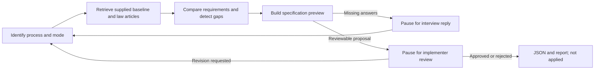

# Requirements discovery graph

This checkpointed workflow is a **legacy developer demo**, outside the backend
turn path. The [stateless agent](stateless-turn.md) is the integration entry point;
it shares this package's retrieval, normalization and comparison logic through tools.

This P0 workflow turns a supplied municipal request and process input-form baseline
into a validated, reviewable change specification. It uses LangGraph, Python and
Pydantic, with read-only template and law retrieval. The existing
`ProcessInterviewAgent` HTTP adapter and `contracts/` remain unchanged.

The [user-supplied implantation questionnaire](https://github.com/jorgeoro14/hackatonAprova/blob/main/docs/modelo-formulario-implantacao.md)
is now loaded directly from the verified local `docs/modelo-formulario-implantacao.md`,
alongside the shared English guide and intent registry. It matches file commit
`acd2de595365622a87f93765b008a1923140dcde`. Provenance and the normalized content
hash live in `knowledge/aprova/implantation-questionnaire.json`; source drift fails
explicitly instead of silently using stale instructions.

The document defines the **whole implantation questionnaire**, including service
summary, applicant form, documents, fees, sectors, workflow, dispatches and final
document. It supplies the interview structure; actual municipal answers and a
filled process input-form baseline remain separate. The agent does not ask for
this already-loaded questionnaire again.

## Components and behavior



`app/requirements/schemas.py` defines the internal `Specification`, changes,
citations, questions and review decisions. `AgentState` retains messages, selected
baseline/version, retrieved evidence, answered question keys, tracked changes,
pending issues, revision history and the current specification. Checkpointers
retain earlier snapshots; revision history also records specification digests.

`analyze_requirements(template=..., legal_context=..., user_request=..., ...)`
is the comparison entry point. Its output contains suggested changes, missing
information, actual retrieved legal references, conflicts and next questions.
The model proposes a complete revision; deterministic checks verify references,
exact quotes, field targets, type taxonomy and condition dependencies. A tracked
change cannot disappear without a recorded withdrawal. Answers may arrive out
of order. Answered semantic question keys are filtered from later questions.

The closed actions are `add_field`, `update_field`, `remove_field`, `set_required`
and `add_condition`. Existing IDs survive label edits. Conditions name a dependency,
operator, value and required/visible effect; missing references, self references,
cycles and unsupported Boolean/selection comparisons block approval. Removal also
needs an explicit dependency audit of existing rules/workflow/document references.

Origins remain distinct:

- `municipality_request`: quote and message ID from a municipal representative.
- `legal_requirement`: exact quote and ID of a retrieved provision; legal validation
  stays pending until a separate implementer checks support and verified applicability.
- `operational_suggestion`: design choice, not a legal requirement or employee answer.
- Missing information: pending questions/blockers, with no invented answers or defaults.

Human input can select use-existing, adaptation or new-form mode. A real baseline
is never selected silently. The normalized `Template` represents the input-form
field block, not an Aprova HTML document template or a submitted citizen process.
`load_team_models()` preserves source IDs, content-hash version and `exemplo` flag.
It reads the canonical field types from `src/knowledge/schemas.ts`; it does not
duplicate or certify the full `ProcessoModelo`/`FormularioImplantacao` envelope.

## Retrieval and current limitations

The optional [remote knowledge adapter](knowledge-api.md) now loads assigned
knowledge, domain guides, system documentation, full process baselines and law
articles through the implemented Node read routes. Its server-owned authorization
scope is refreshed on each retrieval. Additional questionnaire requirements are
captured as provenance-checked `requirement_notes`, pending typed mapping/review.
Exports retain the selected complete process object; no Python HTTP save route
exists. Missing remote configuration leaves the local mode described below.

`search_templates()` searches injected authorized baselines; synthetic models are
excluded unless explicitly enabled. The current team environmental model is an
example, not a retrieved live municipal Aprova form. Public Aprova API templates
describe response shapes and capabilities but do not supply authenticated baselines
or verify the complete builder field taxonomy. `Capabilities` defaults to pending;
an implementer must supply a source-backed mapping before real approval.

`CuratedLawSearch.search_laws()` reads the Cascavel article BM25 index and returns
provenance-rich evidence. It reports the municipal coverage gap as a blocker.
It currently uses lexical retrieval; semantic vectors and hybrid fusion have not
been generated. A future vector/hybrid retriever can implement `LawSearch` without
changing the comparison node. See [the corpus report](../../knowledge_base/reports/collection_report.md).

The Council-hosted Organic Law consolidation dates from 2023; local process codes,
decrees and amendment coverage remain unresolved. Federal act-level effectiveness
does not establish every provision's municipal applicability. In this collected
corpus, applicability stays unverified/conditional, so legal proposals cannot be
approved merely by selecting their citations.

The first release captures form fields and conditions. Documents, fees, dispatches,
signatures and complete workflow parameterization still need coordinated output
contract/mapping work; they must not be disguised as supported field actions.
No frontend/backend integration or Aprova mutation is implemented here.
Exports explicitly state `output_scope: applicant_form_changes` and
`implementation_questionnaire_completed: false`, and retain the questionnaire
source/hash. Field-change approval cannot claim completion of all questionnaire
blocks. Requirements for other blocks are questions/conflicts with target sections,
not invented field actions or a claim of fully typed persistence.

## Test in LangGraph Studio with GPT-6 Luna

The default [root configuration](../../langgraph.json) uses **OpenAI `gpt-6-luna`**
through the live graph factory and loads the ignored root `.env`. Set:

```dotenv
MODEL_PROVIDER=openai
MODEL_NAME=gpt-6-luna
OPENAI_API_KEY=your-local-key
```

`MODEL_API_KEY` remains an optional legacy override; there is no need to duplicate
the secret. The shared provider uses Chat Completions with `reasoning_effort=none`
for Luna so existing tool calls remain compatible with the
[official model guidance](https://developers.openai.com/api/docs/models/gpt-6-luna).
This selects the non-reasoning mode; reasoning with tools would require a separately
evaluated Responses API migration. Other explicitly configured models retain their
existing provider settings. Embedding model selection is independent and remains explicit.

```powershell
uv run --project agents --all-extras langgraph dev --config langgraph.json --no-browser
```

Open [Studio](https://smith.langchain.com/studio/?baseUrl=http://127.0.0.1:2024),
select `requirements`, create a **new thread**, and run
[studio-input.live.json](../examples/requirements/studio-input.live.json).
This makes a live identification call, then asks for the missing real baseline.
The marked synthetic baseline is not silently selected. Resume existing threads
only with the same graph/dependency configuration used to create them.

`langgraph.live.json` remains a compatible explicit live configuration.
Graph factories initialize local catalogs/provider clients in a worker thread
so Studio's event loop remains nonblocking. API credentials stay on the server.

## Synthetic Studio demo

The explicit [demo configuration](../../langgraph.demo.json) registers graph `requirements`
with a deterministic **synthetic** interview and no model calls. The graph uses the
real collected law index and preserves its coverage blocker. Agent Server supplies
checkpointing; the graph factory does not attach a second SQLite saver.

From the repository root:

```powershell
uv sync --project agents --extra rag --extra requirements --extra studio
uv run --project agents --extra rag --extra requirements --extra studio langgraph dev --config langgraph.demo.json --no-browser
```

Open [Studio connected to localhost](https://smith.langchain.com/studio/?baseUrl=http://127.0.0.1:2024)
or [local API documentation](http://127.0.0.1:2024/docs). Studio may ask you to sign
in to LangSmith; the local synthetic graph itself needs no model API key.

1. Select `requirements` and create a new thread.
2. Paste [studio-input.synthetic.json](../examples/requirements/studio-input.synthetic.json)
   into the graph's JSON input and run. The graph pauses at `interview`.
3. In the interrupt resume control, use
   [studio-resume.synthetic.json](../examples/requirements/studio-resume.synthetic.json).
   With the server API, send this object as `command.resume` on the **same thread**;
   do not send a new initial input. The graph proposes an optional contact email
   and pauses at `review` with revision 2.
4. Inspect `specification`, `analysis`, `legal_context` and `history`. The municipal
   coverage blocker deliberately prevents approval of this real-law-backed demo.

Example server resume payload for an interview:

```json
{
  "assistant_id": "requirements",
  "command": {
    "resume": {
      "message": "Add an optional email field.",
      "answered_question_keys": ["contact_channel"],
      "actor_role": "municipal_representative"
    }
  }
}
```

To test a live model, set `MODEL_PROVIDER=openai`, `MODEL_NAME=gpt-6-luna`
and the existing `OPENAI_API_KEY` in the local root `.env` (never paste credentials in chat).
Optionally set `REQUIREMENTS_CAPABILITIES_PATH` to a verified profile;
`REQUIREMENTS_ALLOW_SYNTHETIC=true` only enables the marked team examples.
Use the separate [live configuration](../../langgraph.live.json):

```powershell
uv run --project agents --extra rag --extra requirements --extra studio langgraph dev --config langgraph.live.json --no-browser
```

At an interview pause, Studio accepts a plain-text answer or an `InterviewReply`
JSON object. Omitted actor roles inherit the preceding participant's recorded role,
falling back to `implementer` when unknown. Use the JSON object to explicitly select
a candidate template, change mode or mark question keys answered. Invalid reply
payloads pause again for correction. Approval still requires the separate structured
review decision and reviewer role.

Stop the demo server before starting another server on port 2024. The dev server
is a local debugging surface, not the production HTTP adapter or an authenticated
review service. Use synthetic interviews here. The hosting backend must own actor
authentication, reviewer roles, municipality authorization, thread IDs, turn
serialization, retention and atomic form integration before exposing this workflow.

Configuration follows the official [local-server guide](https://docs.langchain.com/oss/python/langgraph/local-server),
[interrupts guide](https://docs.langchain.com/oss/python/langgraph/interrupts) and
[persistence guide](https://docs.langchain.com/oss/python/langgraph/persistence).

## Local CLI and durable session resume

This alternative uses SQLite under ignored `agents/.local/`, with strict checkpoint
deserialization. It is independent of Studio's development storage.
For a live CLI run, add `--env-file .env` to `uv run` to load the same server settings;
the Python CLI itself does not read `.env` automatically.

```powershell
uv run --project agents --extra requirements python -m agents.scripts.run_requirements --demo --thread demo-1 --start "We need a way to contact applicants."
uv run --project agents --extra requirements python -m agents.scripts.run_requirements --demo --thread demo-1 --reply-json agents/examples/requirements/reply.synthetic.json --export agents/.local/demo-1
uv run --project agents --extra requirements python -m agents.scripts.run_requirements --demo --thread demo-1 --status
```

Exports are `specification.json` and `report.md`. Both retain pending information
and mark the application status `not_applied`. To begin a different interview,
use a new server-owned thread ID; an existing thread cannot be restarted silently.

Review is a separate trusted call, never a model output or a representative chat
message. Resume `review` with a `ReviewDecision` and authenticated implementer role.
Approval requires the exact revision and specification digest, all change IDs,
explicit semantic verification of cited chunks, verified currentness/applicability,
verified platform mapping and zero unresolved blockers. Revisions produce a new
digest. Feedback must explicitly withdraw/replace any earlier captured changes.
Approval records a specification; there is no API action that applies it.

## Validation

```powershell
uv run --project agents --extra rag --extra requirements --extra studio pytest agents/tests
uv run --project agents ruff check agents
uv run --project agents ruff format --check agents
node scripts/check-contracts.mjs
```

The offline scenarios cover quote provenance, absent/revoked/unverified laws,
municipality isolation, unsupported types, stable IDs, conditions, retained requests,
answered questions, strict JSON, partial/stale/unauthorized approvals, role separation,
revisions and SQLite restart recovery. They validate the workflow boundaries;
live model quality and vendor mapping are not established by deterministic tests.
